# Hagstofa AI: Natural-Language Access to Icelandic Statistics

**HAM team · Gagnvist / Hagstofa Hackathon 2026 · Track 2 (PX-API)**

Repository: https://github.com/HFG88/HAM-track2-datathon · Setup: [README.md](README.md) · Visual overview: [docs/prototype-overview.pdf](docs/prototype-overview.pdf)

## Project description

Hagstofa AI is a prototype that helps people find and retrieve official Icelandic statistics by asking questions in everyday language. A user can ask, for example, "Hvað búa margir í Kópavogi?" ("How many people live in Kópavogur?") or ask in English. The system searches Statistics Iceland's tables, selects the relevant data and dimensions, and returns a short answer with its period and source.

We set out to make the PX-API easier to use without requiring users to know table names, API syntax, or official statistical terminology. The prototype combines deterministic code for parsing and validating queries with locally run language models for interpreting questions, ranking candidate tables, and phrasing answers. **Numerical results are retrieved from Statistics Iceland's PX-API; they are not generated by the language model.**

The project provides a web interface and a FastAPI endpoint, `POST /spyrja_px_api`. Responses include the answer, source table and URL, selected dimensions, returned data, timing information, and any notes or errors. Multiple questions in one prompt are answered one by one.

## Architecture

```mermaid
flowchart LR
    U[User question<br/>Icelandic or English] --> F[Web frontend]
    F --> A[FastAPI<br/>POST /spyrja_px_api]
    A --> R[Language routing<br/>and question rewrite]
    R --> N[Normalize question<br/>years, place, intent, breakdowns]
    N --> S[Hybrid table search<br/>BM25 + multilingual vectors]
    S --> C[Candidate tables<br/>topic and year filtering]
    C --> L[LLM ranks tables]
    L --> D[Select table dimensions<br/>and values]
    D --> V[Validate selections<br/>against table metadata]
    V --> P[Statistics Iceland<br/>PX-API]
    P --> Q[Answer from returned data<br/>with period and source]
    Q --> F
```

The language and question-processing flow routes Icelandic and English questions (Icelandic questions are translated to English by a fast model, which also fixes typos and inflected place names), extracts details such as years and breakdowns, and adds search keywords. Table search combines BM25 character n-gram search with a multilingual vector index. Candidate tables are ranked, and the chosen table's dimensions and values are validated against its metadata before a request is sent to the PX-API. Yearly totals of monthly flows and age ranges are summed in code. The answer generator receives the returned data and produces a concise response with provenance.

## How it connects to Statistics Iceland

- **Catalog:** `catalog.py` crawls the PX-API table tree (`https://px.hagstofa.is/pxis/api/v1/is/`) and `enrich_catalog.py` fetches the metadata of all 2,102 tables. This snapshot and the vector index are included in the repository (`data/`) and unpacked automatically on first start.
- **Data:** for every question, `px_query.py` validates the selection against the table's metadata and sends a live POST request to the table's PX-API URL, so answers always reflect the current published data.

## Results and performance

The team evaluated table selection on a set of 83 analytical questions (`AI_test/spurningar.txt`) and 24 shorter questions. These figures measure whether the system selects an acceptable table; they are not a comprehensive measure of end-to-end answer accuracy.

| Table-selection method | 83-question set | 24-question set |
|---|---|---|
| Hybrid search alone | 35/83 | 12/24 |
| Search + Qwen3:30B-A3B table ranking | 39/83 | 17/24 |
| Search + Qwen3:32B table ranking (used) | 44/83 | 17/24 |
| Correct table present in search's top 10 | 55/83 | 21/24 |

All four rows come from the same evaluation run (`python table_choice.py --eval`). Table-choice latency is about 0.7 seconds with Qwen3:30B-A3B and 2–3 seconds with Qwen3:32B on an NVIDIA GB10. End-to-end answers take roughly 7–25 seconds.

On a separate set of 26 everyday questions run end to end through the API, 23 were answered correctly, including population questions for Kópavogur, Reykjavík and Hveragerði (from a misspelled question), Iceland's population in 2024, inflation in 2024, migration, births, unemployment, tourist arrivals in a year (summed over months), the number of people over 67 (summed over ages), cod catch, and a historical population question about Flateyri in 1990. When requested data is unavailable, for example a year beyond a table's coverage, the system says so and gives the latest available period.

## Example questions

- Hvað búa margir í Kópavogi?
- Hver var verðbólgan á Íslandi árið 2024?
- hvað eru margir án vinnu?
- Hvað áttu margir heima á Flateyri 1990?
- Hvað komu margir ferðamenn til Íslands árið 2024?
- How many people live in Reykjavík?
- Hvað búa margir í Kópavogi? Hver var verðbólgan 2024? *(two questions in one prompt)*

## Limitations and next steps

Performance depends on selecting the right table and interpreting its dimensions correctly. Table selection is imperfect, particularly when several tables have similar titles or the question uses unfamiliar wording. Dimension and value selection is largely rule-based; if a place or category in the question does not match the table's labels, the system may fall back to a total rather than the intended breakdown, and the answer then says so. A natural next step is to let the language model choose dimension values from the table's metadata, validated by the existing code.

The PX-API does not return units, so units are inferred from labels (percent, index points) or left out. The service needs a reachable Ollama server with the Qwen3 models (about 40 GB, run on a GPU machine such as the GB10); without it, the app still answers from rules alone but with clearly lower quality. The Hagur model (`hagstofa-ai:latest`) was not available to us, so Qwen3 models are used instead; the model is a setting.

## AI tools used

- **Qwen3 models via Ollama** (in the product): Qwen3:30B-A3B for translating and rewriting questions, Qwen3:32B for table ranking and answer generation, and Qwen3-Embedding 0.6B for vector-based table search. Llama 3.2 3B and Qwen3 4B were tested during development. The language models assist with question understanding, table selection and wording; API validation and numerical data retrieval are handled by project code and the Statistics Iceland PX-API.
- **Claude Code (Anthropic)** (in development): used as a coding assistant to design, write, test and debug much of the pipeline (search, table choice, selections, answer generation, frontend changes) and the documentation, under the team's direction and review.
